# ha-plant-card

[](https://www.home-assistant.io/integrations/marketplace/)
[](https://github.com/juju35/ha-plant-card/actions/workflows/hacs.yml)
[](https://github.com/juju35/ha-plant-card/actions/workflows/validate.yml)
[](https://github.com/juju35/ha-plant-card/actions/workflows/lint.yml)
[](https://github.com/juju35/ha-plant-card/releases/latest)
[](https://github.com/juju35/ha-plant-card/blob/main/LICENSE)
[](https://buymeacoffee.com/julienstep9)

<p align="center"></p>

<p align="center">
  <a href="https://www.home-assistant.io/integrations/xiaomi_ble/"></a>&nbsp;&nbsp;
  <a href="https://www.home-assistant.io/integrations/esphome/"></a>&nbsp;&nbsp;
  <a href="https://www.home-assistant.io/integrations/zha/"></a>&nbsp;&nbsp;
  <a href="https://www.home-assistant.io/integrations/ecowitt/"></a>&nbsp;&nbsp;
  <a href="https://www.home-assistant.io/integrations/tuya/"></a>
</p>

Lovelace cards for Home Assistant for your **indoor and outdoor plants**: every plant drawn as it is — **79 species and 104 varieties**, from the Monstera Albo and the Pilea Mojito to the olive tree and the tomato — with its **pot temperature** and **soil moisture** against the ideal range of its species. The drawing follows the sensors: the foliage droops and a dry leaf falls when the soil is dry, drops run down when it is soaked, frost settles on the pot when it is too cold, heat waves rise when the pot overheats.

The cards work with any soil sensor — [Mi Flora / Xiaomi BLE](https://www.home-assistant.io/integrations/xiaomi_ble/), [ESPHome](https://www.home-assistant.io/integrations/esphome/), Zigbee ([ZHA](https://www.home-assistant.io/integrations/zha/), Zigbee2MQTT), [Ecowitt](https://www.home-assistant.io/integrations/ecowitt/), [Tuya](https://www.home-assistant.io/integrations/tuya/)… — and with the [Plant](https://www.home-assistant.io/integrations/plant/) integration and the [Plant Monitor](https://github.com/Olen/homeassistant-plant) custom integration, whose sensors and thresholds are read by themselves.

[](https://my.home-assistant.io/redirect/marketplace_repository/?owner=juju35&repository=ha-plant-card&category=plugin)

| Plant Card | Plant Mini Card |
|---|---|
| 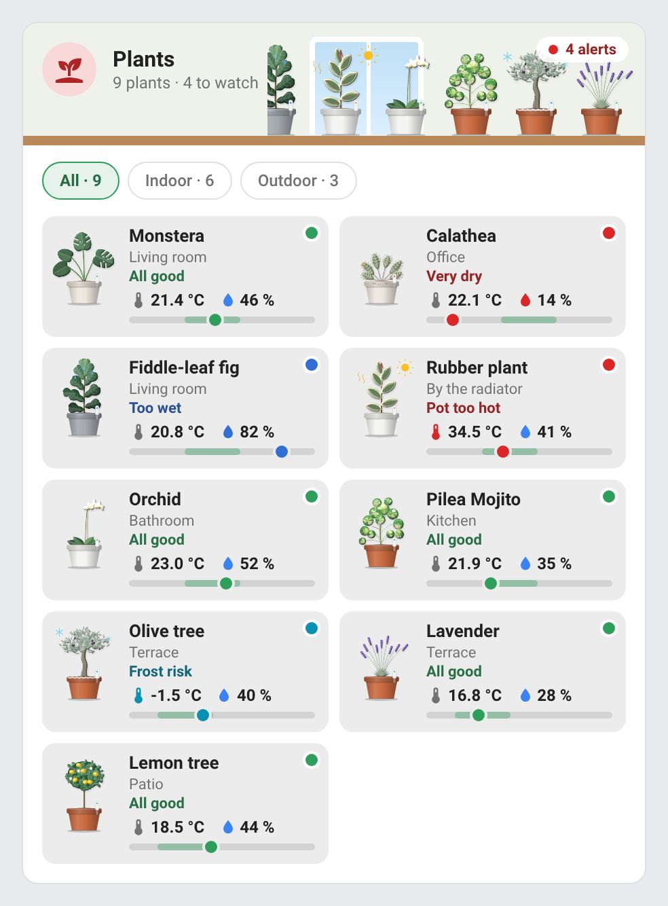 | 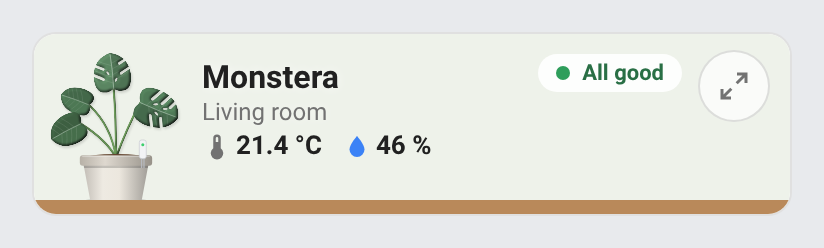<br>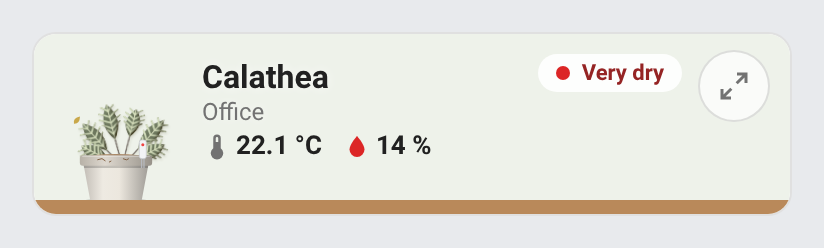<br>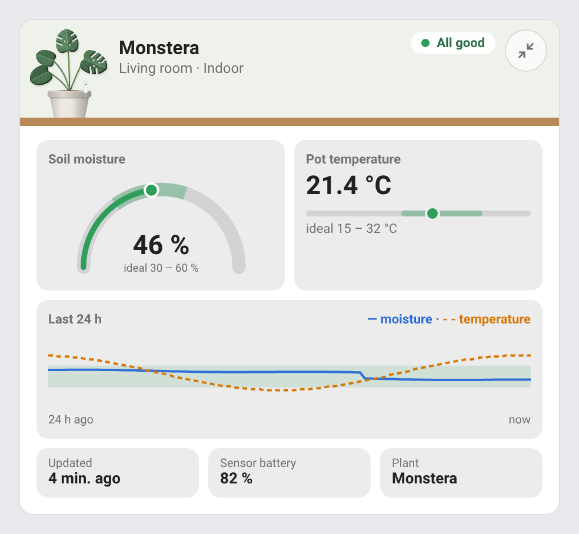 |

## Features

- Two cards: the **Plant Card** (`custom:plant-card`), every plant as a tile, and the **Plant Mini Card** (`custom:plant-mini-card`), one plant
- **79 illustrated plants** (37 indoor, 42 outdoor) and **104 varieties**: variegated leaves (Monstera Albo, Thai Constellation, Pothos Marble Queen, Philodendron Pink Princess, Pilea Mojito…), black, lime, silver or purple foliage, flower and fruit colors (white orchid, blue or pink hydrangea, Queen of Night tulip, Black Krim tomato…) — see [Plants and varieties](#plants-and-varieties)
- The drawing follows the state: dry (drooping, faded foliage, cracked soil, a falling leaf), too wet (drops, soaked soil), too cold or frost (bluish foliage, frost on the rim, snowflakes), pot too hot (sun and heat waves); the soil probe's light takes the state's color
- **Pot temperature and soil moisture** on each tile, with the ideal moisture range as a green band under the value
- Ideal ranges by kind of plant (succulent, tropical, humid, Mediterranean, edible, garden), read from the Plant Monitor's threshold numbers, or set per plant (`min_moisture`, `max_moisture`, `min_temperature`, `max_temperature`)
- States, the worst first: **Very dry**, **Frost risk**, **Pot too hot**, **Needs water**, **Too wet**, **Too cold**, **Check the plant** (a problem reported by the Plant integration), **All good**; a pot temperature in °F is compared in °C
- Illustrated header (90 px): the plants on a shelf in front of a window (a garden when they all live outside), the title, a subtitle (*9 plants · 2 to watch*) and a status pill; night with a dark Home Assistant theme (`illustration_theme` forces day or night)
- **Indoor / Outdoor** filter on the full card when it holds both
- Tap a tile: the plant's **detail** in a popup at the top of the card — a moisture gauge with its ideal range, the pot temperature on its scale, the **last 24 hours** of both, the last update, the sensor's battery and the plant type; a click anywhere else closes it
- Mini card: the plant, its values and its state in the 90 px header; its detail button (top right) expands it into the detail, a click anywhere outside folds it back
- With no `plants` listed, the full card shows every `plant` entity of Home Assistant; the plant type is guessed from the name (*Monstera du salon* is a monstera)
- Visual editor for both cards (the list of plants of the full card is YAML only)
- Light and dark mode, 22 languages (see [Translations](#translations))
- Single file, no external dependency: the plants are drawn by the card itself

## Supported integrations

The cards read standard Home Assistant entities: any integration exposing a soil moisture or temperature sensor works.

| Integration | What the card uses |
|---|---|
| [Xiaomi BLE](https://www.home-assistant.io/integrations/xiaomi_ble/) (Mi Flora, HHCC) | moisture, temperature, battery sensors of the device |
| [ESPHome](https://www.home-assistant.io/integrations/esphome/) | capacitive soil sensors and temperature probes |
| Zigbee — [ZHA](https://www.home-assistant.io/integrations/zha/), [Zigbee2MQTT](https://www.zigbee2mqtt.io/) | soil sensors (Tuya, Sonoff…) |
| [Ecowitt](https://www.home-assistant.io/integrations/ecowitt/) | soil moisture and soil temperature sensors |
| [Tuya](https://www.home-assistant.io/integrations/tuya/) | soil sensors |
| [Plant](https://www.home-assistant.io/integrations/plant/) | the `plant` entity: its moisture and temperature readings and its problem state |
| [Plant Monitor](https://github.com/Olen/homeassistant-plant) (custom) | the `plant` entity, the sensors of its device and its min/max threshold numbers |

## Prerequisites

Home Assistant 2024.8 or later, and a soil moisture and/or temperature sensor per plant (or a `plant` entity).

## Installation

### Via the Marketplace (recommended)

Click the button below to add the repository directly:

[](https://my.home-assistant.io/redirect/marketplace_repository/?owner=juju35&repository=ha-plant-card&category=plugin)

Then click **Install**, and reload your browser when the Marketplace asks you to.

Or manually:

1. Open **Settings → Marketplace → Add from link** (top right; this needs a GitHub account connected)
2. Add `https://github.com/juju35/ha-plant-card` — Type: **Dashboard**
3. Open **Plant Card** and click **Install**
4. Clear your browser cache and refresh

The Marketplace adds the resource `/local/community/ha-plant-card/plant-card.js` for you.

### Manual

1. Download `plant-card.js` and the `plant-card.i18n.*.js` translation files from the [latest release](https://github.com/juju35/ha-plant-card/releases/latest)
2. Copy them all to `/config/www/` (without the translation files, the cards show in English)
3. Go to **Settings → Dashboards → ⋮ → Resources** → Add resource:
   - URL: `/local/plant-card.js`
   - Type: **JavaScript Module**
4. Clear your browser cache and refresh

## Configuration

### Card types

| Type | What it shows |
|---|---|
| `custom:plant-card` | Every plant as a tile, the indoor / outdoor filter, a popup with a plant's detail |
| `custom:plant-mini-card` | One plant in a 90 px header, expanded into its detail |

### Visual editor

Both cards have a visual editor in the dashboard UI. The mini card's editor holds the plant itself (plant entity or device, name, type, variety, location, sensors, ideal ranges); the list of plants of the full card is set in YAML.

### Minimal

```yaml
type: custom:plant-card
```

With no `plants`, the card shows every `plant` entity. A plant from its sensors:

```yaml
type: custom:plant-mini-card
name: Monstera
plant_type: monstera
moisture: sensor.monstera_moisture
temperature: sensor.monstera_temperature
```

### Full options

```yaml
type: custom:plant-card
title: Plants
columns: auto            # auto, 1, 2, 3 or 4
show_header: true
show_filter: true
illustration_theme: auto # auto, day or night
plants:
  - name: Monstera
    plant_type: monstera
    variety: albo
    room: Living room
    moisture: sensor.monstera_moisture
    temperature: sensor.monstera_temperature
    battery: sensor.monstera_battery
  - entity: plant.olive_tree      # Plant / Plant Monitor: sensors and thresholds read from it
    location: outdoor
  - device: 0f4d…                 # a soil sensor device: its sensors are found by themselves
    name: Pilea
    plant_type: pilea
    variety: mojito
    min_moisture: 25
    max_moisture: 55
```

```yaml
type: custom:plant-mini-card
entity: plant.calathea
plant_type: calathea
variety: white-fusion
room: Office
zoom: true
```

### Options reference

Card options:

| Option | Card | Default | Description |
|---|---|---|---|
| `title` | full | `Plants` | Title of the header |
| `plants` | full | every `plant` entity | The plants, each as below (or a plant entity id). **YAML only** |
| `columns` | full | `auto` | Columns of tiles (`auto`: 1 on a narrow card, 2, 3 on a wide one) |
| `show_header` | full | `true` | The illustrated header |
| `show_filter` | full | `true` | The indoor / outdoor filter (shown when the card holds both) |
| `zoom` | mini | `true` | The detail button of the top right corner |
| `illustration_theme` | both | `auto` | `day` or `night` forces the scene, `auto` follows the theme |
| `language` | both | Home Assistant's | Language of the card (see [Translations](#translations)) |

Plant options (an item of `plants`, or the mini card itself):

| Option | Default | Description |
|---|---|---|
| `entity` | — | A `plant` entity (Plant or Plant Monitor): its readings, sensors and thresholds are read from it |
| `device` | the plant entity's device | A device whose moisture, temperature and battery sensors (and Plant Monitor threshold numbers) are found by themselves |
| `name` | the entity's or device's name, else the plant's | Name of the plant |
| `plant_type` | guessed from the name | The drawing and the default ideal ranges (see [Plants and varieties](#plants-and-varieties)) |
| `variety` | — | A variety of the plant type |
| `location` | the plant type's | `indoor` or `outdoor` (the filter, the scene of the detail) |
| `room` | — | A room or place, shown under the name |
| `moisture` | found on the device | Soil moisture sensor (%) |
| `temperature` | found on the device | Pot temperature sensor (°C or °F) |
| `battery` | found on the device | Battery of the sensor (%) |
| `min_moisture`, `max_moisture` | by kind of plant | Ideal soil moisture (%): a number or an entity id (number, input_number, sensor) |
| `min_temperature`, `max_temperature` | by kind of plant | Ideal pot temperature (°C): a number or an entity id |
| `pot` | the plant type's | The pot: `ceramic`, `white`, `concrete`, `terracotta`, `sage`, `bowl`, `planter` or `tray` |

### Default ideal ranges

| Kind | Plants | Soil moisture | Pot temperature |
|---|---|---|---|
| Succulent | cacti, aloe, echeveria, haworthia, jade plant, agave, snake plant, ZZ plant, yucca | 10 – 40 % | 8 – 35 °C |
| Tropical | most houseplants (monstera, ficus, pothos, philodendron, pilea…) | 30 – 60 % | 15 – 32 °C |
| Humid | calathea, fern, peace lily, alocasia, Venus flytrap, begonia, anthurium, cyclamen, bromeliad, hydrangea | 40 – 70 % | 15 – 30 °C |
| Mediterranean | olive, lemon and orange trees, lavender, rosemary, thyme, sage, oleander, palm, fig tree | 15 – 45 % | 0 – 38 °C |
| Edible | tomato, basil, peppers, zucchini, lettuce, parsley, chives, mint, strawberry, raspberry, blueberry | 35 – 65 % | 8 – 35 °C |
| Garden | rose, geranium, sunflower, petunia, tulip, dahlia, camellia, maple, bamboo, boxwood… | 30 – 60 % | −5 – 35 °C |
| Tender | hibiscus, bougainvillea | 30 – 60 % | 7 – 35 °C |

The state is **Very dry** under 60 % of the minimum moisture, **Frost risk** at 2 °C or less (under the minimum temperature), **Pot too hot** over the maximum temperature.

## Plants and varieties

| Plant | `plant_type` | Default location | Varieties (`variety`) |
|---|---|---|---|
| Monstera | `monstera` | indoor | `albo` (Albo Variegata), `thai` (Thai Constellation), `aurea` (Aurea) |
| Fiddle-leaf fig | `ficus-lyrata` | indoor | — |
| Snake plant | `sansevieria` | indoor | `moonshine` (Moonshine), `black-gold` (Black Gold), `zeylanica` (Zeylanica) |
| Pothos | `pothos` | indoor | `marble-queen` (Marble Queen), `neon` (Neon), `njoy` (N'Joy), `jade` (Jade) |
| Cactus | `cactus` | indoor | `fleur-jaune` (Yellow flower) |
| Aloe vera | `aloe` | indoor | `christmas` (Christmas) |
| Orchid | `orchidee` | indoor | `blanche` (White), `jaune` (Yellow), `violette` (Purple) |
| Calathea | `calathea` | indoor | `white-fusion` (White Fusion), `medallion` (Medallion) |
| ZZ plant | `zamioculcas` | indoor | `raven` (Raven), `variegata` (Variegata) |
| Chinese money plant | `pilea` | indoor | `mojito` (Mojito), `sugar` (Sugar), `splash` (White Splash) |
| Peace lily | `spathiphyllum` | indoor | `domino` (Domino) |
| Boston fern | `fougere` | indoor | — |
| Kentia palm | `kentia` | indoor | — |
| Rubber plant | `ficus-elastica` | indoor | `tineke` (Tineke), `ruby` (Ruby), `robusta` (Robusta) |
| Dragon tree | `dracaena` | indoor | `tricolor` (Tricolor), `bicolor` (Bicolor) |
| Spider plant | `chlorophytum` | indoor | `vert` (Green) |
| Echeveria | `echeveria` | indoor | `pourpre` (Perle von Nürnberg) |
| Tomato | `tomate` | outdoor | `noire` (Black Krim), `jaune` (Yellow) |
| Basil | `basilic` | outdoor | `pourpre` (Purple) |
| Lavender | `lavande` | outdoor | `blanche` (White), `rose` (Rosea) |
| Rose bush | `rosier` | outdoor | `rose` (Pink), `blanc` (White), `jaune` (Yellow), `orange` (Orange) |
| Olive tree | `olivier` | outdoor | — |
| Lemon tree | `citronnier` | outdoor | — |
| Strawberry | `fraisier` | outdoor | `pineberry` (Pineberry (white)) |
| Geranium | `geranium` | outdoor | `rose` (Pink), `blanc` (White), `violet` (Purple) |
| Hydrangea | `hortensia` | outdoor | `bleu` (Blue), `rose` (Pink), `annabelle` (Annabelle (white)) |
| Sunflower | `tournesol` | outdoor | `velvet-queen` (Velvet Queen) |
| Mint | `menthe` | outdoor | — |
| Rosemary | `romarin` | outdoor | — |
| Japanese maple | `erable-japon` | outdoor | `vert` (Viridis (green)), `orange` (Katsura (orange)) |
| Bamboo | `bambou` | outdoor | `noir` (Black bamboo) |
| Boxwood | `buis` | outdoor | — |
| Chili pepper | `piment` | outdoor | `jaune` (Yellow), `violet` (Purple) |
| Thyme | `thym` | outdoor | — |
| Lettuce | `laitue` | outdoor | `chene-rouge` (Red oak leaf) |
| Philodendron | `philodendron` | indoor | `pink-princess` (Pink Princess), `birkin` (Birkin), `brasil` (Brasil), `lemon-lime` (Lemon Lime) |
| Alocasia | `alocasia` | indoor | `black-velvet` (Black Velvet), `frydek` (Frydek) |
| Bird of paradise | `strelitzia` | indoor | `nicolai` (Nicolai (white flower)) |
| Yucca | `yucca` | indoor | `variegata` (Variegata) |
| Jade plant | `crassula` | indoor | `tricolor` (Tricolor) |
| Bonsai | `bonsai` | indoor | — |
| Venus flytrap | `dionee` | indoor | `red-dragon` (Red Dragon) |
| Anthurium | `anthurium` | indoor | `rose` (Pink), `blanc` (White), `noir` (Black Queen) |
| Ivy | `lierre` | indoor | `glacier` (Glacier), `goldchild` (Goldchild) |
| Wandering dude | `tradescantia` | indoor | `nanouk` (Nanouk), `quicksilver` (Quicksilver) |
| Peperomia | `peperomia` | indoor | `variegata` (Variegata) |
| Croton | `croton` | indoor | — |
| Weeping fig | `ficus-benjamina` | indoor | `starlight` (Starlight) |
| Money tree | `pachira` | indoor | `variegata` (Variegata), `simple` (Single trunk), `simple-variegata` (Single trunk variegata) |
| Zebra plant | `haworthia` | indoor | — |
| Polka dot begonia | `begonia` | indoor | — |
| Cyclamen | `cyclamen` | indoor | `blanc` (White), `rouge` (Red) |
| Poinsettia | `poinsettia` | indoor | `blanc` (White), `rose` (Pink) |
| Bromeliad | `bromelia` | indoor | `jaune` (Yellow), `orange` (Orange) |
| Barrel cactus | `cactus-boule` | indoor | — |
| Petunia | `petunia` | outdoor | `rouge` (Red), `blanc` (White), `rose` (Pink) |
| Tulip | `tulipe` | outdoor | `rouge` (Red), `jaune` (Yellow), `blanche` (White), `queen-of-night` (Queen of Night) |
| Agapanthus | `agapanthe` | outdoor | `blanche` (White) |
| Bougainvillea | `bougainvillier` | outdoor | `orange` (Orange), `blanc` (White) |
| Raspberry | `framboisier` | outdoor | `jaune` (Yellow (Fallgold)) |
| Blueberry | `myrtille` | outdoor | — |
| Zucchini | `courgette` | outdoor | `jaune` (Yellow) |
| Parsley | `persil` | outdoor | — |
| Chives | `ciboulette` | outdoor | — |
| Windmill palm | `palmier` | outdoor | — |
| Agave | `agave` | outdoor | `variegata` (Americana Variegata) |
| Dahlia | `dahlia` | outdoor | `cafe-au-lait` (Café au lait) |
| Daisy | `marguerite` | outdoor | — |
| Hibiscus | `hibiscus` | outdoor | `rose` (Pink), `jaune` (Yellow) |
| Oleander | `laurier-rose` | outdoor | `blanc` (White), `rouge` (Red) |
| Orange tree | `oranger` | outdoor | — |
| Fuchsia | `fuchsia` | outdoor | `blanc-rose` (White and pink) |
| Pansy | `pensee` | outdoor | — |
| Sage | `sauge` | outdoor | `pourpre` (Purpurascens) |
| Bell pepper | `poivron` | outdoor | — |
| Ornamental grass | `graminee` | outdoor | `rubrum` (Pennisetum Rubrum) |
| Fig tree | `figuier` | outdoor | — |
| Jasmine | `jasmin` | outdoor | — |
| Camellia | `camelia` | outdoor | `blanc` (White), `rouge` (Red) |

## Screenshots

### Animations

One animation per state of the drawing (the foliage sways on the mini card and in the detail; the effects of a state play everywhere):

| State | Light | Dark |
|---|---|---|
| All good — the foliage sways, the probe's light blinks | 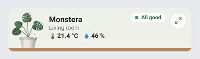 | 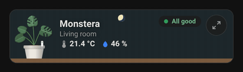 |
| Needs water — the foliage droops and a dry leaf falls | 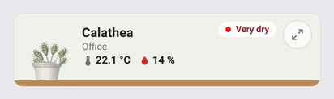 | 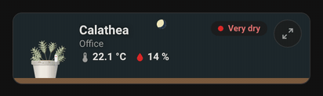 |
| Too wet — drops run down onto the soaked soil | 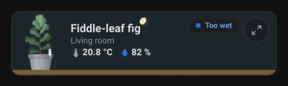 | 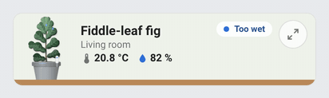 |
| Pot too hot — the sun shines and heat waves rise | 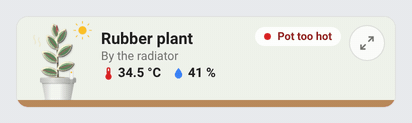 | 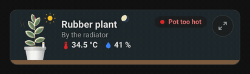 |

### Plant Card

| Light | Dark |
|---|---|
|  | 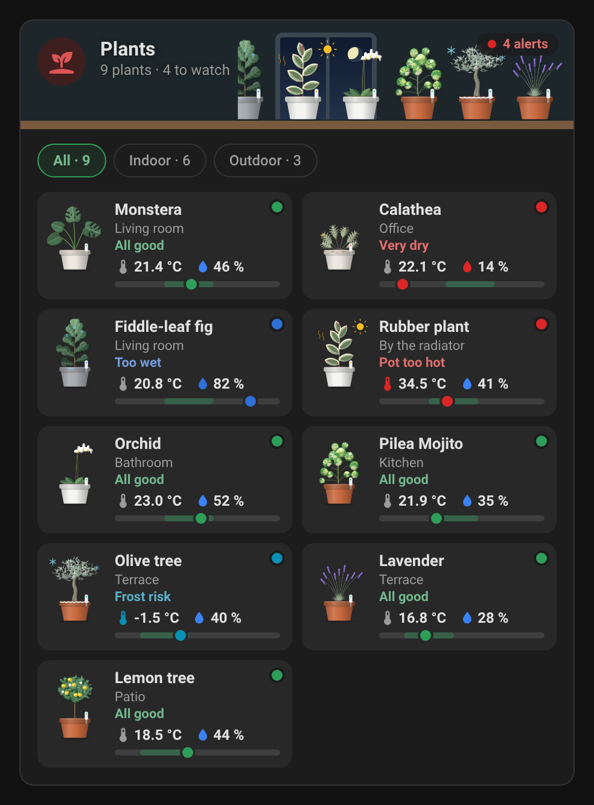 |
| 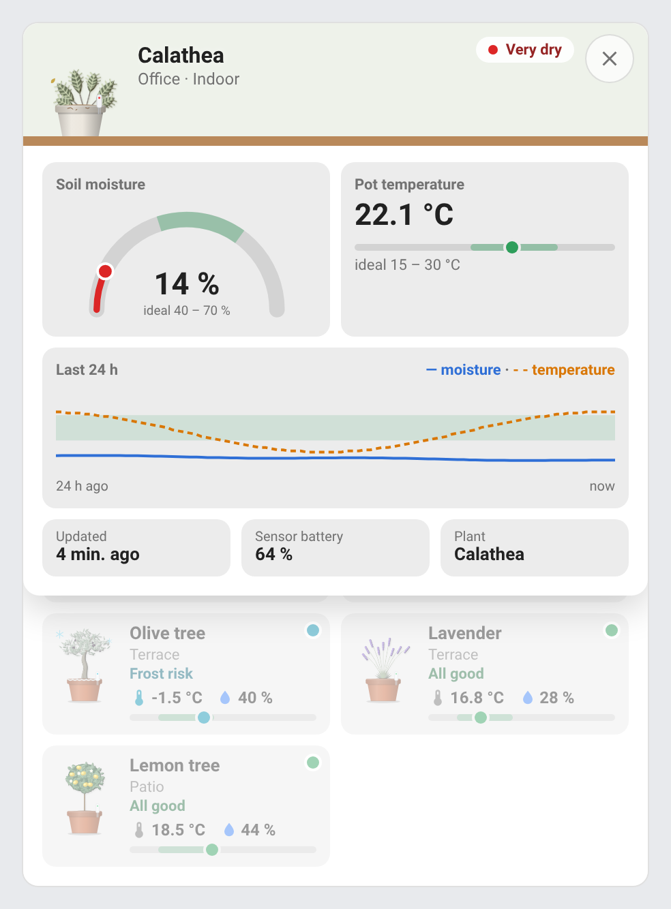 | 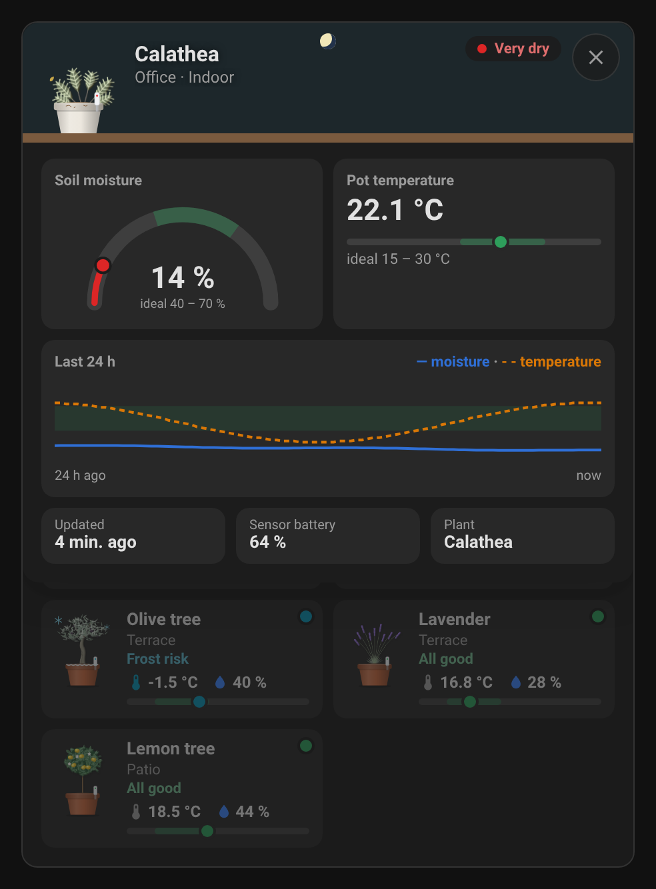 |
| 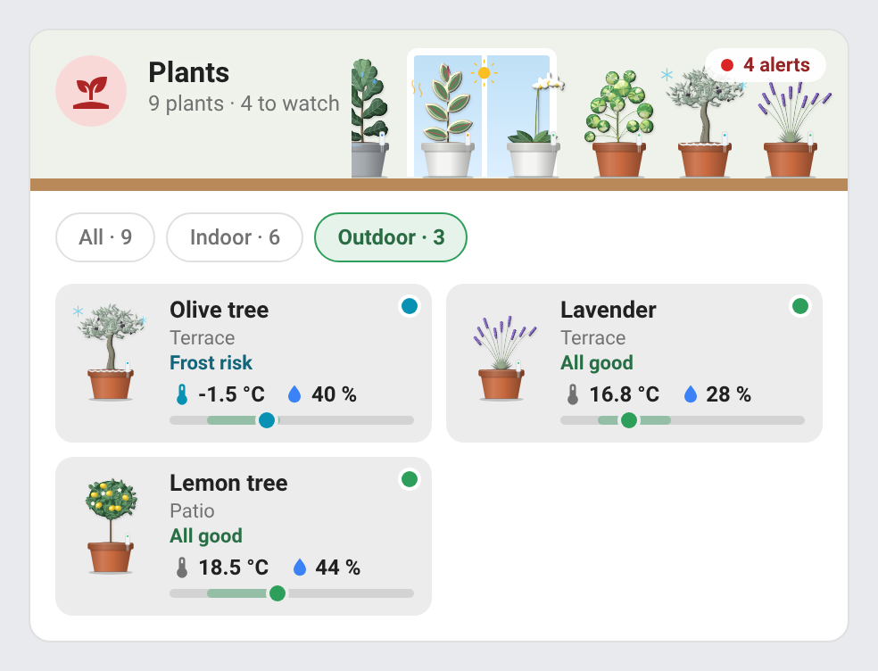 | 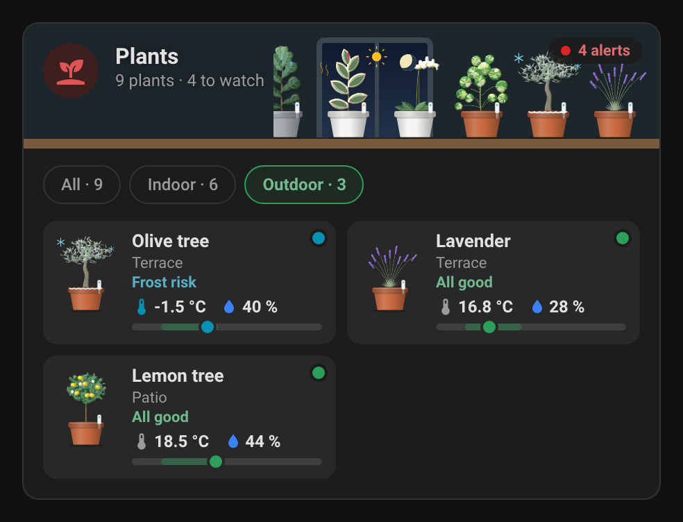 |
| 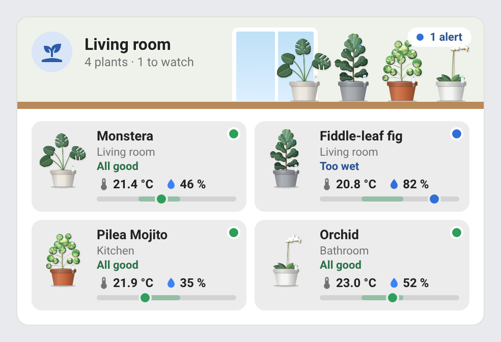 | 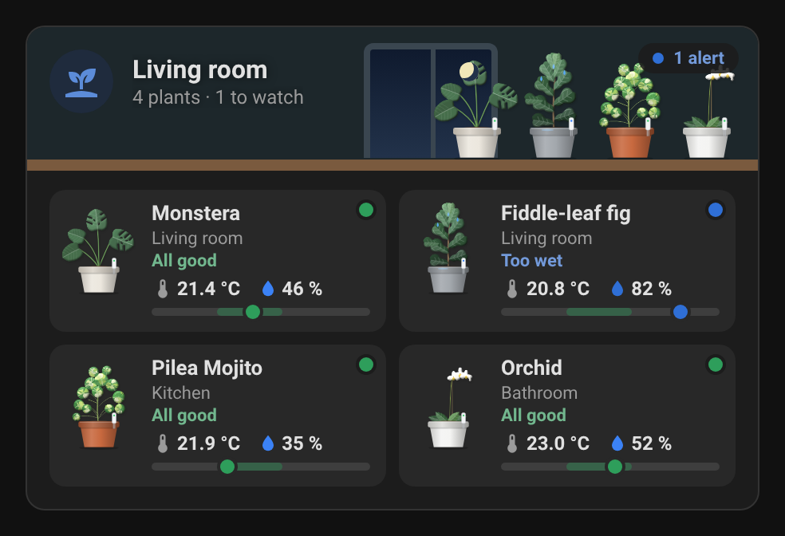 |
| 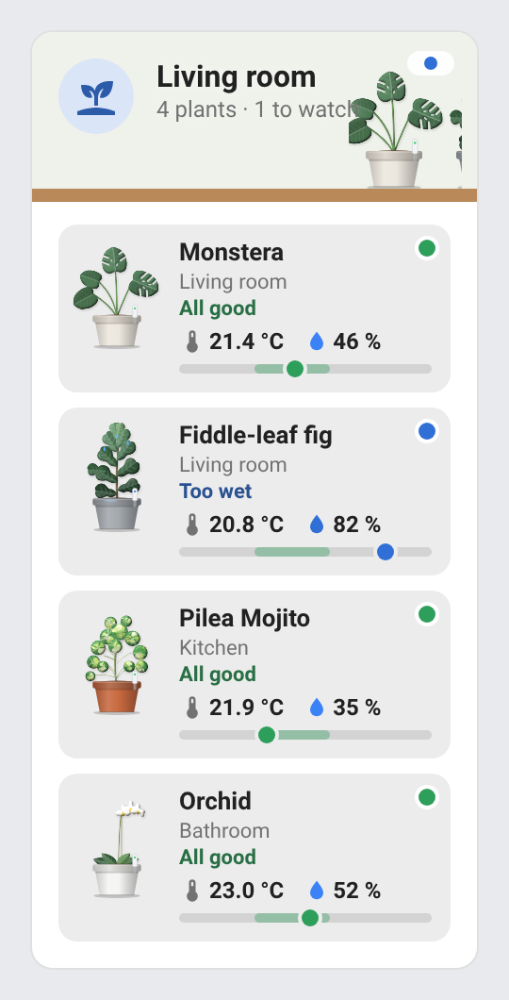 | 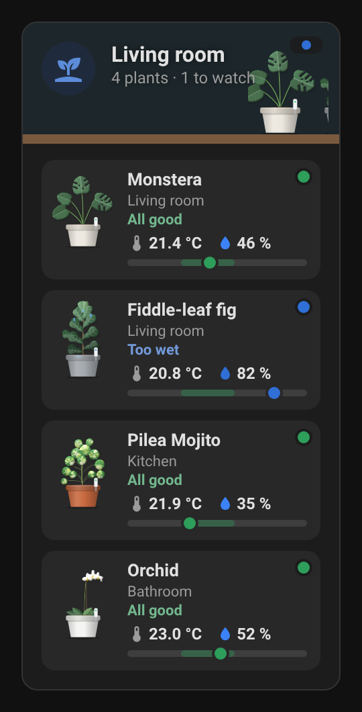 |

### Plant Mini Card

| Light | Dark |
|---|---|
|  | 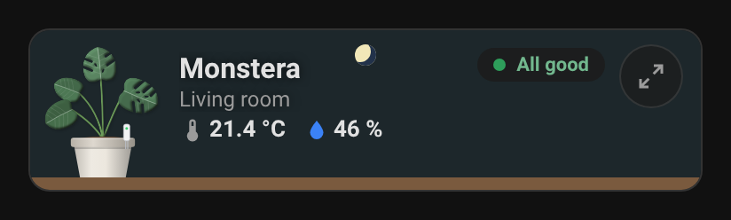 |
|  | 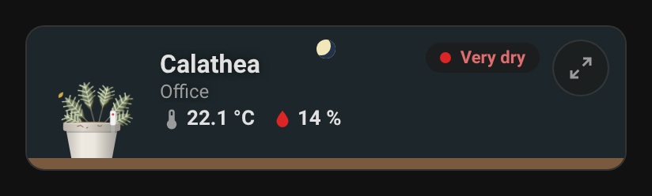 |
| 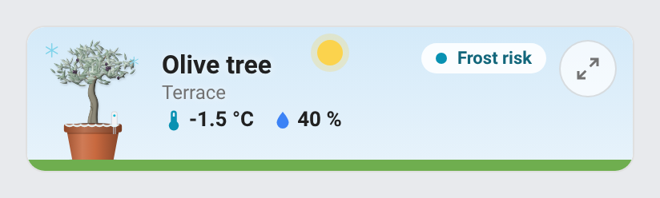 | 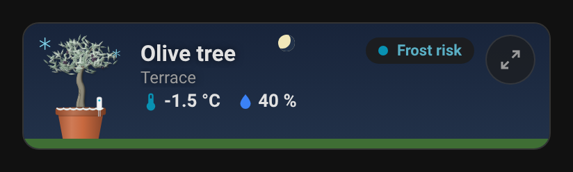 |
|  | 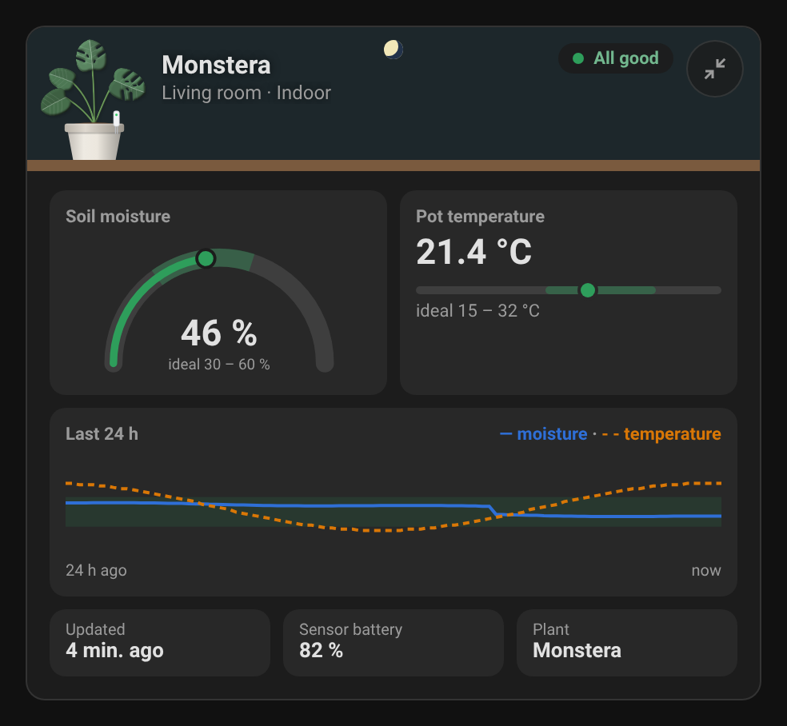 |

## How it works

- A plant is resolved from its options: a `plant` entity gives its readings (Plant) or its device (Plant Monitor), whose moisture, temperature and battery sensors are found by their device class and whose min/max threshold numbers set the ranges; a `device` works the same way; `moisture`, `temperature` and `battery` override what was found.
- The plant type gives the drawing and the default ideal ranges; a variety recolors the plant or adds a variegation pattern to its leaves.
- The drawing of a plant in a state is cached: Home Assistant's frequent updates redraw nothing that did not change, and the card redraws in place.
- The detail asks Home Assistant for the last 24 hours of the moisture and temperature sensors (recorder history), cached for 5 minutes.

## Development

```bash
npm install
npm run build        # bundles src/ into dist/plant-card.js (+ one translation file per language)
npm run check        # builds and checks the card (run in CI)
npm test             # unit tests (node --test)
npm run screenshots  # renders the cards (and one GIF per animated state, needs ffmpeg) with mock data into screenshots/
```

The source is split into ES modules under `src/` (entry `src/index.js`); `npm run build` assembles them (`scripts/bundle.mjs`) into the single file the Marketplace serves. The plants are drawn by `src/plants.js`.

`dist/` is not committed: `npm run build` creates it locally, CI builds it on every push, and the release workflow attaches the built files to the release, which is where the Marketplace installs it from. The screenshots are rendered by the **Screenshots** workflow on pull requests and committed to the pull request's branch.

### Releasing

1. Bump `version` in `package.json` (and `package-lock.json`, with `npm install`)
2. Add a `## <version>` section at the top of [CHANGELOG.md](https://github.com/juju35/ha-plant-card/blob/main/CHANGELOG.md)
3. Merge a `feat` or `fix` pull request: the **Release** workflow builds the card, creates the tag and the GitHub release with the changelog sections as notes, and attaches `plant-card.js` and its translation files

## Translations

The cards auto-detect the language from your Home Assistant settings. Currently supported:

| Language | Code |
|---|---|
| English | `en` |
| Français | `fr` |
| Deutsch | `de` |
| Español | `es` |
| Српски | `sr` |
| Srpski (latinica) | `sr-Latn` |
| Italiano | `it` |
| Nederlands | `nl` |
| Português (European; also used for `pt-BR`) | `pt` |
| Polski | `pl` |
| Română | `ro` |
| Dansk | `da` |
| Svenska | `sv` |
| Български | `bg` |
| Русский | `ru` |
| Українська | `uk` |
| Magyar | `hu` |
| Slovenčina | `sk` |
| Čeština | `cs` |
| Slovenščina | `sl` |
| Latviešu | `lv` |
| Ελληνικά | `el` |

Plant and variety names are shown in French with the French language, in English otherwise. Contributions for additional languages are welcome!

## Credits

Xiaomi, Mi Flora, ESPHome, Zigbee, Ecowitt and Tuya are trademarks of their respective owners. This project is not affiliated with any of them. Icons from [Material Design Icons](https://pictogrammers.com/library/mdi/). The ideal ranges are general guidance: follow the needs of your own plants.

## License

[MIT](https://github.com/juju35/ha-plant-card/blob/main/LICENSE)

## Support

If you find this project useful, you can support its development:

<a href="https://buymeacoffee.com/julienstep9"></a>
